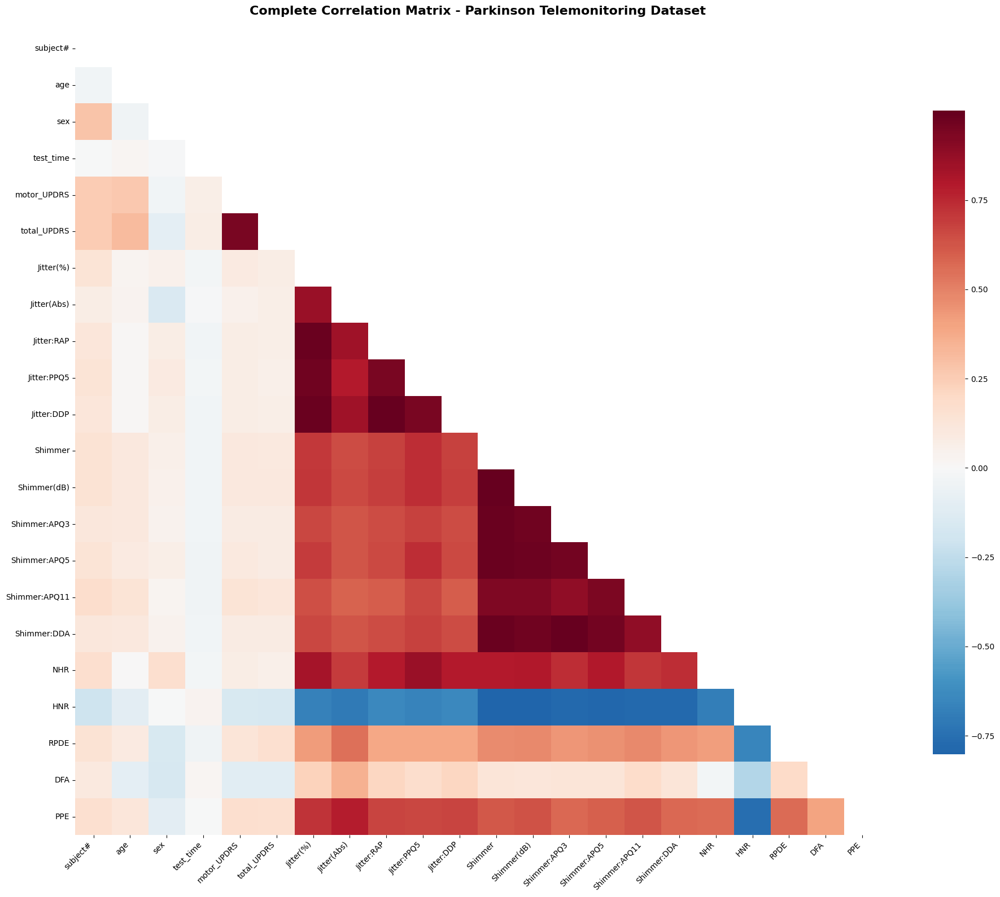
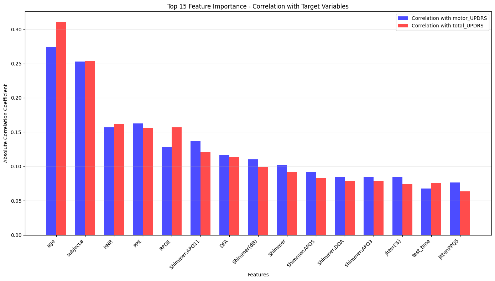

# Parkinson's Disease Telemonitoring: Exploratory Data Analysis

Which voice measurements track Parkinson's disease severity? This project explores the UCI Parkinson's Telemonitoring dataset and relates biomedical voice features to the clinical UPDRS scores.



## Data

5,875 voice recordings from 42 people with early-stage Parkinson's disease, collected at home over six months. Each recording has 16 voice measures (jitter, shimmer, HNR, RPDE, DFA, PPE) plus age, sex and two targets: `motor_UPDRS` and `total_UPDRS`.

## What the analysis covers

- Distribution of both UPDRS targets
- Correlation of every feature with each target
- Multicollinearity between voice features

## Findings

- **Strongest signals:** age, HNR (harmonics-to-noise ratio) and PPE (pitch period entropy) have the strongest relationships with UPDRS.
- **HNR is negatively correlated with severity:** noisier voices go with higher UPDRS scores.
- **Heavy redundancy:** 29 feature pairs have correlation above 0.8, and `Shimmer:APQ3` and `Shimmer:DDA` are perfectly correlated. A model built on this data should drop duplicates or use PCA first.



## Files

| File | Contents |
|---|---|
| `parkinsons_eda_project.ipynb` | Cleaning, plots and statistical analysis |
| `parkinsons_telemonitoring.csv` | Raw dataset |
| `correlation_matrix.csv` | Feature-to-feature correlations |
| `feature_importance_results.csv` | Feature rankings against the targets |
| `*.png` | Charts exported from the notebook |

## How to run

```bash
git clone https://github.com/mehtesham13/Exploratory-Data-Analysis.git
cd Exploratory-Data-Analysis
pip install pandas numpy matplotlib seaborn
jupyter notebook parkinsons_eda_project.ipynb
```

Data source: [UCI Machine Learning Repository](https://archive.ics.uci.edu/dataset/189/parkinsons+telemonitoring)

Author: Muhammad Ehtesham · [LinkedIn](https://www.linkedin.com/in/muhammad-ehtesham-dsa)
